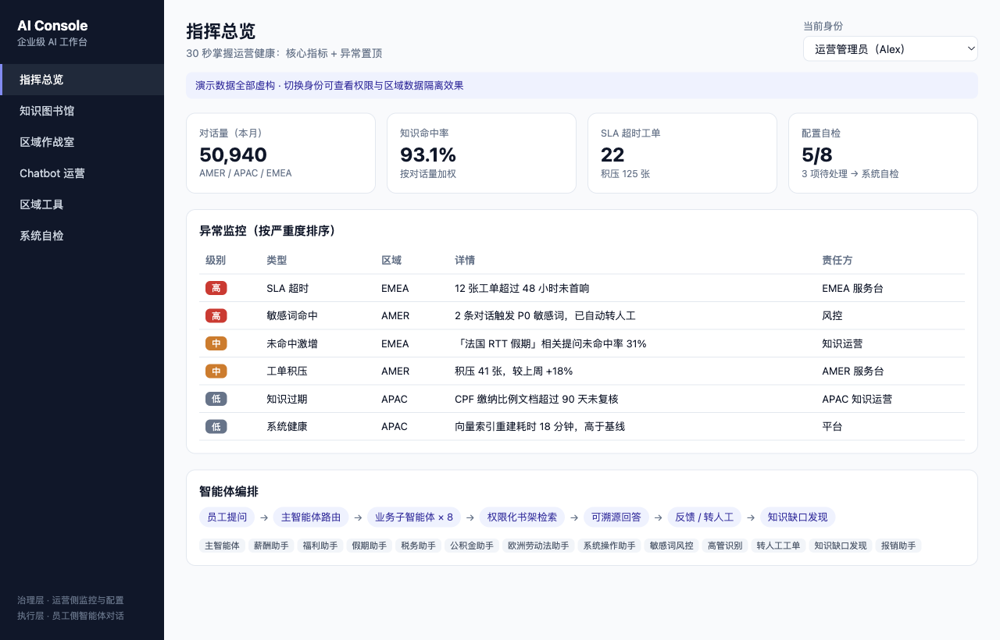
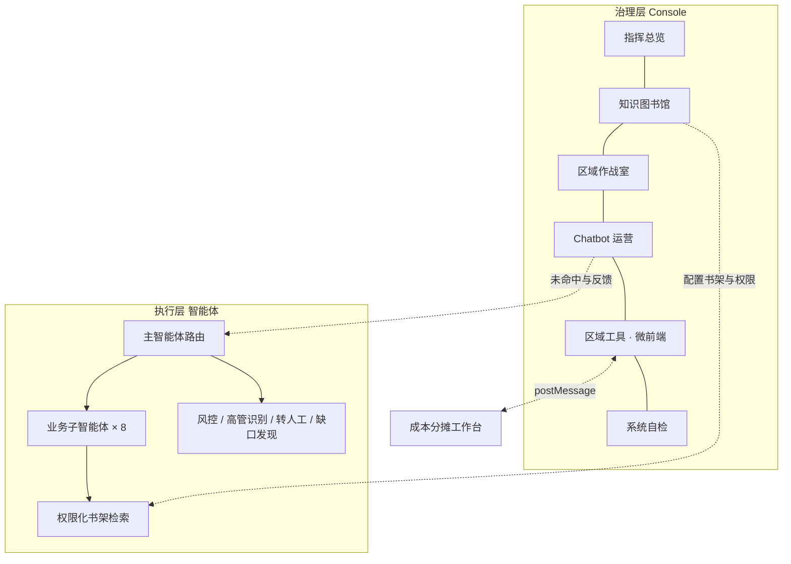
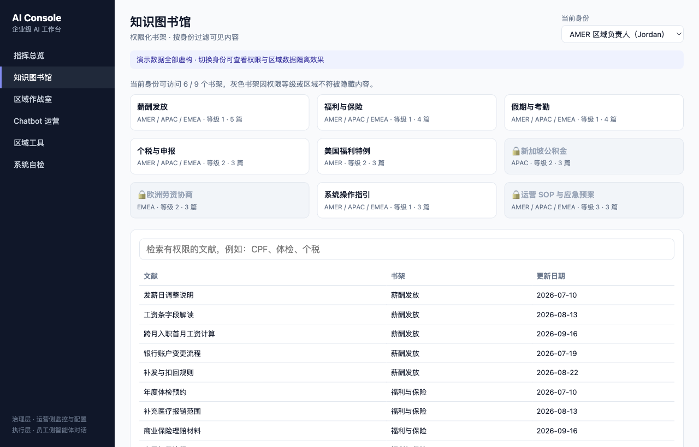
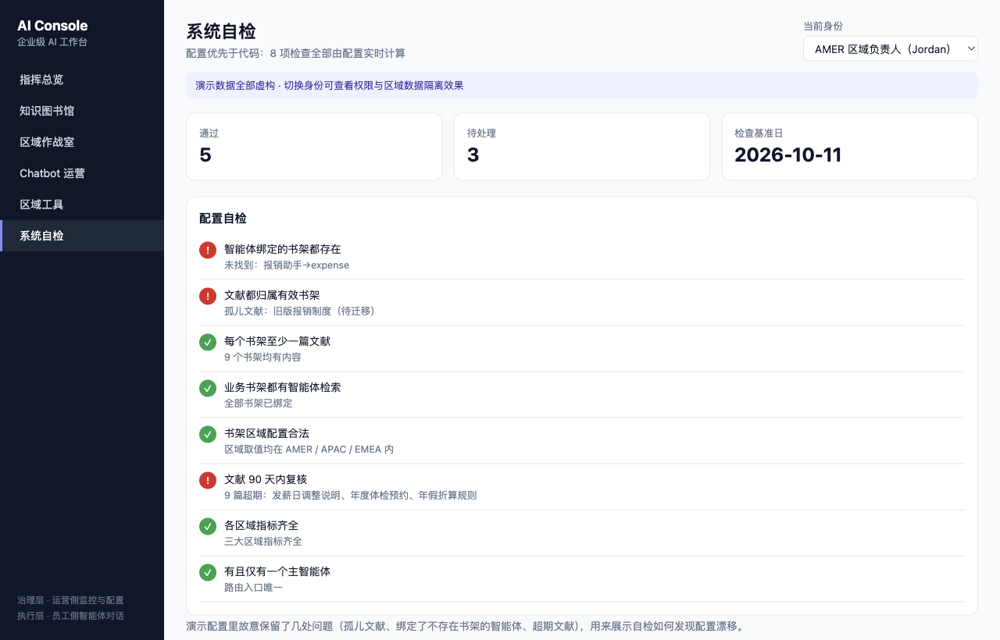

# Enterprise AI Console · 企业级 AI 工作台

**把分散在多个系统里的运营工作，收拢到一个按身份分权、能自检配置的指挥台。**


> **Copyright © 2026 张文婧 (Anna Zhang)** · [MIT License](./LICENSE) · [github.com/annawzhang](https://github.com/annawzhang)  
> 欢迎学习与面试查阅；保留版权与许可声明。**禁止删除作者信息后冒充本人作品二次发表。** 公开内容为虚构/脱敏演示数据。


[在线演示](https://annawzhang.github.io/enterprise-ai-console/) · [运行测试](https://annawzhang.github.io/enterprise-ai-console/tests.html)

面向企业员工服务（薪酬、福利、假期、税务等）的 AI 运营工作台。员工侧由智能体 7×24 回答问题，
运营侧在 Console 里看指标、管知识、处理异常、使用区域工具。核心设计是 **执行层与治理层解耦**：
智能体负责实时对话，Console 负责监控和配置，两边独立迭代。

> 演示数据全部虚构。右上角切换身份，可以直接看到权限和区域数据隔离的效果。



## 解决什么问题

| 痛点 | 做法 |
|---|---|
| 运营要在多个系统间来回切换，30 分钟都看不全运营健康 | 指挥总览：4 个核心指标 + 按严重度置顶的异常清单 |
| 知识文档谁都能看，敏感 SOP 和区域特例混在一起 | 权限化书架：按「权限等级 × 区域」双维度过滤，检索结果也不泄露无权限内容 |
| 各区域数据混看，区域负责人看到别区的工单 | 区域作战室：只能进入有权限的区域 |
| 区域小工具各自部署，身份要重复登录 | 微前端：子应用 iframe 嵌入，Console 统一下发身份，子应用回传结果 |
| 智能体绑定了不存在的书架、文档过期没人发现 | 系统自检：8 项检查全部由配置实时计算，配置一改结果跟着变 |

## 架构



## 六个板块

| 板块 | 看点 |
|---|---|
| 指挥总览 | 对话量、加权命中率、SLA 超时、自检通过数；异常按严重度排序 |
| 知识图书馆 | 9 个书架 × 3 级权限 × 3 个区域；灰色书架为无权限，检索只返回可见文献 |
| 区域作战室 | AMER / APAC / EMEA 分区，无权限区域按钮禁用 |
| Chatbot 运营 | 各区域未命中率周趋势、高频未命中问题、「建库 → 用库 → 补库」闭环 |
| 区域工具 | 嵌入 [成本分摊工作台](https://github.com/annawzhang/cost-allocation-workbench)，消息总线实时显示父子通信 |
| 系统自检 | 书架绑定、孤儿文献、空书架、无人检索、区域合法性、90 天复核、指标齐全、主智能体唯一 |



## 关键产品决策

1. **执行与治理解耦**：员工侧对话追求实时与稳定，运营侧配置追求灵活，拆开后互不拖累。
2. **权限双维度**：只按角色分权不够，区域特例（如新加坡公积金）需要再按区域隔离。
3. **配置优先于代码**：书架、权限、智能体绑定都写在 `src/data.js`，自检直接读配置，
   演示配置里故意保留了 3 处问题，用来展示自检如何发现配置漂移。
4. **微前端而非大单体**：子工具独立部署、独立迭代，父壳只负责身份、导航和消息。



## 本地运行

```bash
# 在同时包含 enterprise-ai-console 与 cost-allocation-workbench 的目录下启动
python3 -m http.server 8000
# 打开 http://localhost:8000/enterprise-ai-console/
```

| 文件 | 作用 |
|---|---|
| `src/data.js` | 角色、书架、文献、智能体、区域指标等演示配置 |
| `src/core.js` | 权限判断、检索过滤、指标汇总、配置自检（纯函数） |
| `src/app.js` | 页面渲染、路由与 iframe 消息通信 |
| `tests.html` | 浏览器内单元测试（8 项） |

## 背景

本项目是作者在企业级 AI 工作台实习中所做总控台的公开复刻版：保留了信息架构、权限模型与微前端设计，
系统名称、数据与配置均已替换为虚构内容。
